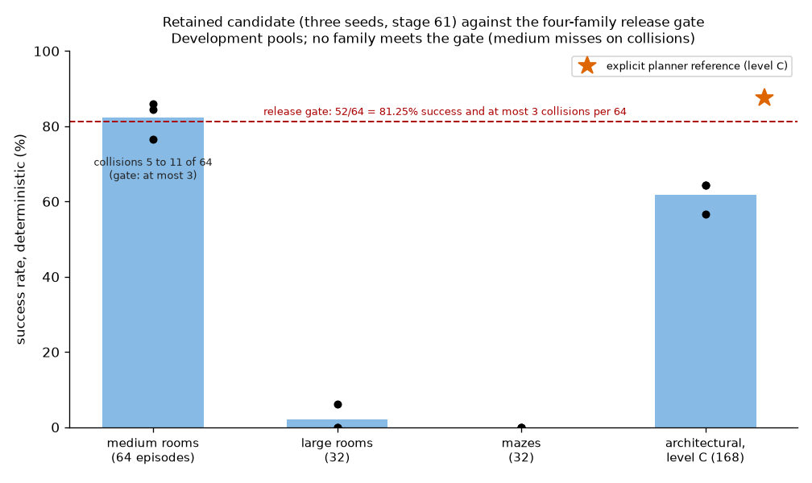
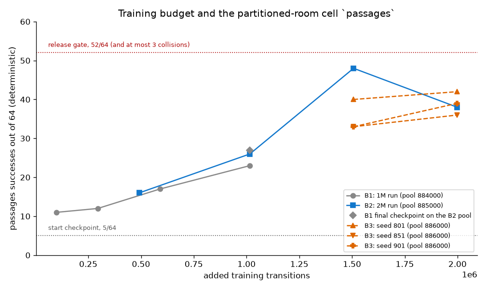
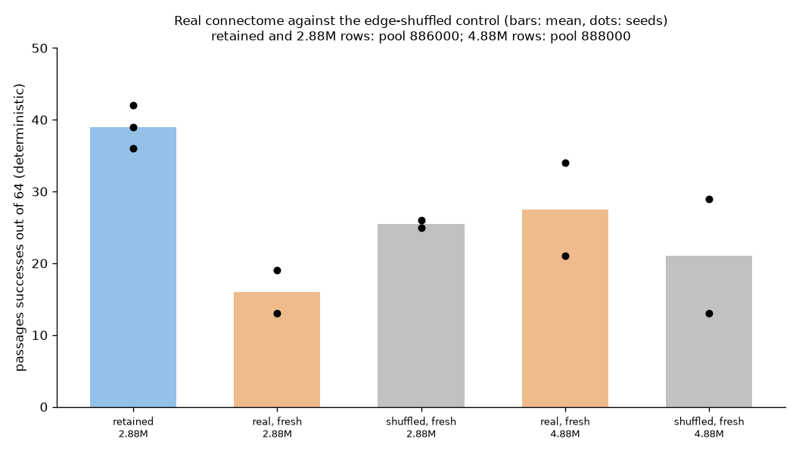
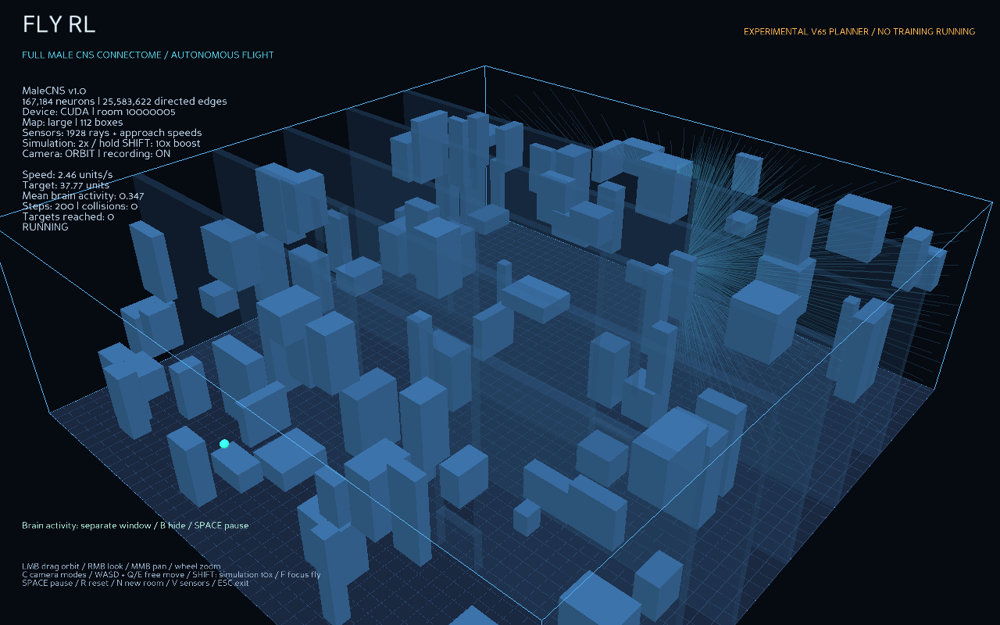
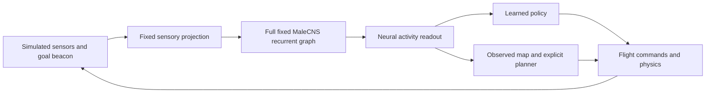

# Fly RL

A virtual fruit fly flies in procedurally generated 3D rooms. Its controller is the full annotated MaleCNS v1.0 connectome (167,184 neurons, 25,583,622 directed edges) used as a fixed recurrent reservoir, with a PPO actor and critic reading 256 pooled features on top. The final objective is a **learned fly that reaches goals in maps it has never trained on**. A separate explicit planner, which searches over an observed map, is kept as a reference and never counts as a learned result.

This repository holds the code, the experiments and the written record of that work. It is an engineered experiment, not a simulation of biological vision, spiking neurons or wing aerodynamics: sensors, neural equations, sensory projection and flight dynamics are project choices, and neural colors show modeled activity, not measured firing.

**Where it stands.** With the full connectome in the loop and no privileged input, the best learned policy reaches goals in new medium rooms (49 to 55 of 64), in about 60 percent of new partitioned rooms of its training family (`passages` 36 to 42 of 64), and partly in a held-out family of six synthetic architectural scenes (95 to 108 of 168, against 71 for the starting policy). It does not navigate large rooms or mazes (0 to 2 of 32 per cell). The release gate, at least 52 of 64 successes and at most 3 collisions in each of four families, is **not met in any family**. A matched control with the connectome's wiring shuffled did as well as the real connectome within the measured spread, so the connectome's own contribution is not shown. Every number is a development-pool result; no reserved final pool has been opened.

[Findings](docs/results/FINDINGS.md) · [Key numbers](docs/results/KEY_NUMBERS.md) · [Project history](docs/overview/PROJECT_HISTORY.md) · [Experiments](docs/experiments/README.md) · [Maps](docs/methods/MAPS.md) · [Brain](docs/methods/BRAIN.md) · [Reproduce](docs/operations/REPRODUCE.md) · [Roadmap](ROADMAP.md) · [All documentation](docs/README.md)

## Contents

1. [Results at a glance](#results-at-a-glance)
2. [What was done](#what-was-done)
3. [What was tried and what worked best](#what-was-tried-and-what-worked-best)
4. [The maps](#the-maps)
5. [The brain](#the-brain)
6. [Controls and the planner reference](#controls-and-the-planner-reference)
7. [Install and run](#install-and-run)
8. [How the experiment is organized](#how-the-experiment-is-organized)
9. [Repository map](#repository-map)
10. [Limits and open questions](#limits-and-open-questions)
11. [Credits and licenses](#credits-and-licenses)

## Results at a glance



All learned numbers below are from the **2M recipe** (the starting policy trained for 1,998,848 more transitions, three seeds), deterministic actions, 64 episodes per cell unless marked. They are development and inspected pools, and a single recipe.

| Cell | Result | Start policy | Gate (successes, collisions) |
| --- | --- | --- | --- |
| Medium dense rooms | 49, 54 and 55 of 64 (5 to 11 collisions) | 51 of 64 | 52 of 64, at most 3 |
| `passages` (three partitions, 4 x 4 m openings, clutter) | 42, 36 and 39 of 64 (8 to 16 collisions) | 5 of 64 | same |
| `passages-mid` | 56, 57 and 54 of 64 | not run | same |
| `passages-wide` and `gate-two` | 64 of 64 on every seed | not run | same |
| Level B: held-out parameter region (narrow openings, at least four partitions) | 26, 17 and 12 of 64 (inconclusive by its frozen rule) | 1 of 64 | same |
| Level C: held-out family, six architectural scenes (168 episodes) | 95, 108 and 108 of 168 (positive by its rule, uneven by scene) | 71 of 168 | 81 percent, at most 5 percent collisions |
| Large rooms (32 episodes) | 2, 0 and 0 of 32 | not run | same |
| Mazes (32 episodes) | 0, 0 and 0 of 32 | not run | same |
| Explicit planner reference, level C | 147 of 168 (4 collisions) | not applicable | not a learned result |

The tables with denominators, pool status and sources are in [KEY_NUMBERS.md](docs/results/KEY_NUMBERS.md). The claims the evidence supports and does not support are listed in [FINDINGS.md](docs/results/FINDINGS.md#a-summary-and-claims).

## What was done

The work ran in 16 numbered iterations, told in full in the [project history](docs/overview/PROJECT_HISTORY.md). The learned line, the planner line and the zero-shot program are kept apart there.

| Iteration | What happened | Outcome |
| --- | --- | --- |
| 1 | Full-connectome foundation: reservoir, small room, sensors, cameras, recording | The full graph runs in a 3D room; behavior untrained |
| 2 | First PPO, rewards and curricula, larger dense rooms, coordinated movement, brain inspection windows | Small-room policy 32/32 on legacy seeds; coordinated dense policy 43/64 on a final pool |
| 3 | Versioned sensors, approach curriculum, collision-risk objective, fresh-start comparison | Medium dense-room policies 35 to 50 of 64; neither the curriculum nor the risk term beat its control |
| 4 | Progressive geometry for large rooms, the zero-success outcome, passage mastery | Large rooms 0/64 on the final pool; one wide opening learned (61/64 on `gate-long`) |
| 5 | Guided navigation, neural waypoint, panoramic sensors, a bounded two-hour window | Every learned large-room correction stayed at 0/8 on development rooms |
| 6 | Explicit observed-map planner for large rooms | Planner-1.0 13/16 prospective, planner-1.2 15/16; not a learned result |
| 7 | Maze contract and the room-aware planner series | Maze 7/8 retained and 5/8 fresh; closed without a passing fresh gate |
| 8 | Architectural scenes and planner-1.4 | Planner 19/21 on the original objectives |
| 9 | Planner-free autonomous PPO pilots and architectural curricula | 0/6 to 1/6 validation goals; no route navigation learned |
| 10 | Recovery of the historical medium-room policies; transfer experiments 1 to 8 | 50/64, 48/64 and 45/64 recovered and replayed; partitioned rooms barely learned |
| 11 | Held-out specification, variance study, stabilization and memory screening | Seed spread up to 11 episodes of 32; stabilization and memory did not meet their criteria |
| 12 | Randomized map sampler, random-distribution run, diagnostics | Negative; the diagnostics point to route information at decision time |
| 13 | Auxiliary head, privileged critic, supervised pretraining | All negative: `passages` +2.3, +0.7 and +2.0 of 64 |
| 14 | Training budget (1M, 2M, three seeds) and level B and C | Budget is the lever: `passages` 5 to 36-42 of 64 |
| 15 | Connectome control (edge-shuffled reservoir) and planner reference | No connectome contribution shown; planner 147/168 on level C |
| 16 | Consolidation of the documentation | This reorganization |

## What was tried and what worked best

The best learned configuration is the plain PPO recipe of the stabilization bundle run for a much larger budget: 32 simulators (8 medium, 12 `passages-mid`, 4 `passages`, 4 `passages-wide`, 4 `gate-two`), clip 0.1, 3 epochs, minibatch 256, `target_kl` 0.02, gamma 0.995, learning rate falling from 3e-4 to 3e-5, started from a retained and hash-verified checkpoint. At 1M transitions `passages` was 23 of 64 on one seed, at 2M 38 and then 36 to 42 on three seeds.



| Intervention | Question | Result |
| --- | --- | --- |
| More training budget (same recipe) | Does `passages` need more exposure? | Yes: 5 to 36-42 of 64 at 2M |
| Graded gates and 50 percent medium rooms | Can partitioned rooms be learned without forgetting medium? | Partly; medium kept, `passages` stayed low at 98k to 262k |
| Route-progress reward, longer horizon | Does a denser reward help? | No; the reward audit shows it does not favor hovering |
| Stabilization bundle, memory window | Does a stable trainer or history help? | One seed held, the other did not; memory not replicated |
| Random-map mix with adaptive difficulty | Does randomization help? | No; the difficulty controller stayed at 0.2 to 0.25 |
| Auxiliary head, privileged critic, supervised pretraining | Can a training-only route signal help? | No (+2.3, +0.7, +2.0 of 64) |
| Route direction as an actor input (diagnostic, not a student) | Is the missing information the limit? | Yes: `passages` 37.5 against 11 |
| Guided supervision, panorama sensors, spatial readout (large rooms) | Can learned corrections fix large rooms? | No; 0/8 on development rooms each |
| Explicit planner | Is there a working reference? | Large 15/16, maze 5/8 fresh, architectural 19/21 on development rooms |

The full list, with links to every protocol and result, is in [FINDINGS.md](docs/results/FINDINGS.md#d-what-was-tried) and the [experiment catalog](docs/experiments/README.md). The lessons about method (separate selection and report pools, three seeds and 64 episodes per comparison, declaring deterministic or sampled evaluation, treating model-written diagnoses as hypotheses) are in [FINDINGS.md](docs/results/FINDINGS.md#e-methodological-lessons).

## The maps

The maps are generated by the same geometry code that training and evaluation use. Each profile has a certified reference route and a route-dependent deadline that the controller never sees. [Maps](docs/methods/MAPS.md) lists every profile with its parameters.


The held-out parameter region (level B) and the held-out family (level C) are never drawn in training:


| Profile family | Dimensions (m) | Role |
| --- | --- | --- |
| Original small room, `gate-near`, `gate-long`, `gate-two` | 12 x 12 x 6 to 24 x 12 x 10 | Early demo, gate progression, training mix |
| `dense-v3` (medium) | 32 x 32 x 12, 48 boxes | Historical medium-room task, regression suite |
| `passages-wide`, `passages-mid`, `passages` | 32 x 32 x 12, three partitions | The partitioned-room cells of the zero-shot program |
| `large`, `maze` | 48 x 48 x 16 and 64 x 64 x 20 | Large-room and maze families, planner development |
| Randomized sampler, level B region | 28 to 48 by 28 to 44 by 10 to 16 | Random-map training and the held-out parameter region |
| Six architectural scenes, 21 situations | fixed geometry | Level C, the held-out family |

A passing geometry test or a generated map does not mean a controller can navigate it: map structure matters more than size labels. A long room with one wide gate can be easier than a smaller room with several narrow passages.

## The brain

The connectome is a fixed reservoir. A random sensory projection drives its 167,184 neurons, the activity is pooled into 256 features, and the PPO policy reads those features. PPO optimizes the actor and critic, not the synapses. [Brain](docs/methods/BRAIN.md) gives the equations, sensors, readouts and the viewer's brain views.


The viewer shows the room and the brain in separate windows. The anatomical view uses 140,033 supplied soma positions; the other 27,151 neurons compute without supplied coordinates. Colors show modeled activity, not experimental firing or a causal explanation of movement.


## Controls and the planner reference

The control keeps everything except who connects to whom: the target of every edge is permuted (same neurons, edges, degrees, weights and signs), so only the specific wiring is removed. It was trained from random weights in a matched chain with the real connectome.




On medium rooms the two arms learn equally well (61 and 54 of 64). On the harder cells the fresh chain did not reach the retained policy's level at either budget (2.88M and 4.88M transitions), and the two seeds of each arm differ by as much as the arms do (13 to 16 episodes). No cell favors the real connectome. The project therefore cannot claim that the biological wiring improves or is necessary for navigation; showing a 10-episode difference would take about eight seeds per arm. Details: [C1.0](docs/experiments/connectome-control/CONNECTOME_CONTROL_RESULTS_C10.md), [C1.1](docs/experiments/connectome-control/CONNECTOME_CONTROL_RESULTS_C11.md), [C1.2](docs/experiments/connectome-control/CONNECTOME_CONTROL_RESULTS_C12.md).

The explicit planner (an observed-map controller that reads the same connectome activity and chooses actions by search) is the other reference. It scores 147 of 168 on the architectural scenes it was developed on, and its results on large rooms and mazes are development figures, not matched pools ([planner reference](docs/experiments/connectome-control/PLANNER_REFERENCE_RESULTS.md), [planner documentation](docs/planner/PLANNER_DEVELOPMENT.md)).



That image is a rendered verification of the planner on the original large room, not performance evidence.

## Install and run

Tested on Windows with Conda, Python 3.11, PyTorch 2.7.1+cu128, Stable-Baselines3 2.7.0, Panda3D 1.10.16, and an NVIDIA RTX 3060 with 12 GB VRAM. CUDA is the default; CPU execution is available through the CLI, but full-graph interactive performance there is unestablished. [Tested versions](requirements-lock.txt).

From the repository root, with Conda installed:

```powershell
powershell.exe -NoProfile -ExecutionPolicy Bypass -File .\setup.ps1
.\.conda\python.exe -s -m fly_rl --help
.\launch-observed-map.cmd
```

Setup creates the local `.conda`, installs dependencies, and downloads and prepares the pinned connectome. It requires network access and substantial storage. A fresh clone contains source, public evidence and images, but no downloaded data, trained checkpoints or flight archives; the experiments that need them are marked in [REPRODUCE.md](docs/operations/REPRODUCE.md).

**The observed-map demo requires prepared data but no trained checkpoint.** It computes live sensors, neural activity and planner actions; it is not a recording of a successful flight. The room and brain open in separate windows. Optional arguments:

```powershell
.\launch-observed-map.cmd --speed 4 --seed 370001
.\launch-observed-map.cmd --record-brain
.\launch-observed-map.cmd --controller-version 1.2 --seed 10000005
```

To see an untrained policy interface instead:

```powershell
.\.conda\python.exe -s -m fly_rl demo --map-profile large --dynamics coordinated --brain-view
```

Other launchers: `launch-large.cmd` (planner-1.3-exp.9, verified on six retained and eight fresh large rooms), `launch-maze.cmd` (planner-1.3-exp.11, which reaches both retained maze goals; fresh development 5/8), `launch-architecture.cmd` (N changes situation, G changes scene), and the older `launch-dense.cmd`, `launch-flight.cmd` and `launch-demo.cmd` for local historical models, whose trained weights are not shipped. The `.cmd` wrappers explicitly invoke PowerShell to avoid `.ps1` associations opening an editor. [Commands](docs/operations/COMMANDS.md) covers other modes and checkpoint loading.

Viewing never starts training or modifies weights. Checkpoint loading runs live inference; replay restores saved states without executing a brain. Sensor, dynamics and readout contracts prevent silent reinterpretation. Explicit transfer does not establish performance in a new task.

| Control | Action |
| --- | --- |
| Space | Pause/resume |
| Shift | Request ten times the simulation rate while held |
| R / N | Reset this room / generate the next room |
| C / F | Cycle orbit, chase and free cameras / focus on the fly |
| Mouse drag / wheel | Rotate, pan, look, or zoom |
| WASD and Q/E | Move the free camera, including altitude |
| V | Toggle sensor rays |
| B | Open or restore the brain window |
| Escape | Exit and finalize recording |

Shift changes simulation speed, not physical acceleration or maximum flight speed. Compute and rendering limit achieved acceleration; physics keeps its 0.05-second timestep. See [flight and neuron inspection](docs/methods/FLIGHT_AND_NEURONS.md).

**Verification** (none of these trains a policy):

```powershell
.\.conda\python.exe -s -m pytest -q -p no:cacheprovider
.\.conda\python.exe -s scripts/verify_repository.py
.\.conda\python.exe -s scripts/verify_publication.py .
.\.conda\python.exe -s scripts/check_doc_links.py
```

To rerun an experiment, see [REPRODUCE.md](docs/operations/REPRODUCE.md); to regenerate the report figures, `scripts/make_report_figures.py`.

## How the experiment is organized



The graph contains 167,184 neurons, 25,583,622 directed edges and 124,176,995 represented synapses after the documented annotation filter. [Data and model](docs/overview/DATA_AND_MODEL.md), [architecture](docs/overview/ARCHITECTURE.md) and [mathematics](docs/methods/MATHEMATICS.md) explain the assumptions and optimization equations.

Training fits parameters. Practice can control curriculum progression. Validation selects candidates. Optimization maps guide design changes. Prospective development measures a frozen version on new maps. A reserved final test follows selection and is then consumed. These are not combined into one success curve, and tests, finite losses, reload compatibility and teacher arrivals do not substitute for autonomous results. Every protocol is committed before its run, evaluation pools are kept apart from selection pools, and negative results are reported with the same detail as positive ones ([pools registry](ROADMAP.md#8-pools-registry)).

Each demo retains a unique archive in `runs/demo/`, with metadata, states, actions and integrity checks. `--record-brain` adds full-neuron snapshots. Planner sessions archive controller code and specification rather than a fictitious PPO checkpoint. [Operations](docs/operations/OPERATIONS.md) explains storage, replay, recovery and backups.

## Repository map

```text
fly_rl/connectome/     Data preparation, audits, fixed brain, anatomy, readouts, the edge-shuffled control
fly_rl/simulation/     Sensors, rooms, map profiles, random-map sampler, architectural scenes, flight dynamics
fly_rl/navigation/     Observed-map planner and its versioned controllers
fly_rl/training/       Policies, PPO, supervision, curricula, selection, evaluation, diagnostics
fly_rl/visualization/  Live windows, cameras, neural inspection, and plots
fly_rl/recordings/     Telemetry, integrity checks, recovery, and replay
tests/                 Checks grouped by responsibility
scripts/               Trainers, evaluation drivers, probes, rendering, verification (see scripts/README.md)
docs/overview/         Plans, architecture, data, project history, glossary
docs/methods/          Formulas, sensors, maps, brain, protocol specifications
docs/planner/          The explicit planner line: large rooms, maze, architectural scenes
docs/learning/         Early learned-policy line and autonomous learning
docs/experiments/      One folder per experiment family, protocols and results, and the catalog
docs/results/          Findings, key numbers, earlier aggregate results
docs/operations/       Commands, reproduction, verification, publication, storage
docs/reference/        Credits, references, bibliography
docs/evidence/         Small tracked evidence files (indexed)
docs/images/           Geometry previews, report figures and provenance
ROADMAP.md             Live status board, decisions, pools registry, artifact index
private/               Detailed local journals and machine evidence; ignored
data/, runs/, reports/ Downloaded data, checkpoints and experiments, generated output; ignored
.conda/                Local dependencies; ignored
```

The public tree contains aggregate evidence rather than machine logs or model binaries. Back up ignored artifacts independently. [Contributing](CONTRIBUTING.md) covers code boundaries and checks; [public release preparation](docs/operations/PUBLICATION.md) covers export, history separation and licensing. The README that preceded the zero-shot program is archived in [EARLIER_README.md](docs/overview/EARLIER_README.md).

## Limits and open questions

- The four-family release gate is not met in any family, and no reserved final pool (level A report 940000 to 949999, level B final 960000 to 969999, level C final headings 970000 to 979999) has been opened.
- Large rooms and mazes are open for learned policies. The planner works on its development rooms; maze reliability is 5 of 8 on the fresh suite.
- Collisions remain above the gate everywhere: 8 to 16 per 64 on `passages`, 5 to 11 on medium, 45 to 54 per 168 on level C.
- Results rest on one start, one recipe and up to three seeds. Seed spread is large, and single comparisons under about 10 episodes are not results.
- Level C is 21 fixed situations with eight initial headings each. It is clustered and inspected, so it is descriptive, not a sample of buildings.
- The connectome's contribution is not shown; settling it would take far more seeds than this project used.
- The next steps are the write-up (a short paper, a long paper and an extended academic report built from these documents) and, still open, one more training step aimed at collisions and at large rooms and mazes. The live plan is the [roadmap](ROADMAP.md).

## Credits and licenses

Original project code and documentation use the [MIT license](LICENSE). MaleCNS data retains its separate **CC BY 4.0** license; MIT does not relicense the dataset or dependencies. Preserve original attribution and identify transformations when sharing derived data.

The MaleCNS reconstruction, annotations and soma coordinates were produced by the FlyEM team at HHMI Janelia Research Campus, the University of Cambridge Department of Zoology, the MRC Laboratory of Molecular Biology, Google Research, and contributors credited in the [official project](https://male-cns.janelia.org/).

Cite Berg, S., Beckett, I. R., Costa, M., et al. (2026), *Sexual dimorphism in the complete Drosophila male central nervous system connectome*, Cell, 189(18), 5504–5526.e15. [DOI](https://doi.org/10.1016/j.cell.2026.08.015). The source license is linked on the [official download page](https://male-cns.janelia.org/download/).

Fly RL filters and transforms those tables; the original researchers did not produce this controller or its results. [Credits and references](docs/reference/REFERENCES.md) describes modifications and reusable citations. Use the [documentation index](docs/README.md) for the remaining guides.
