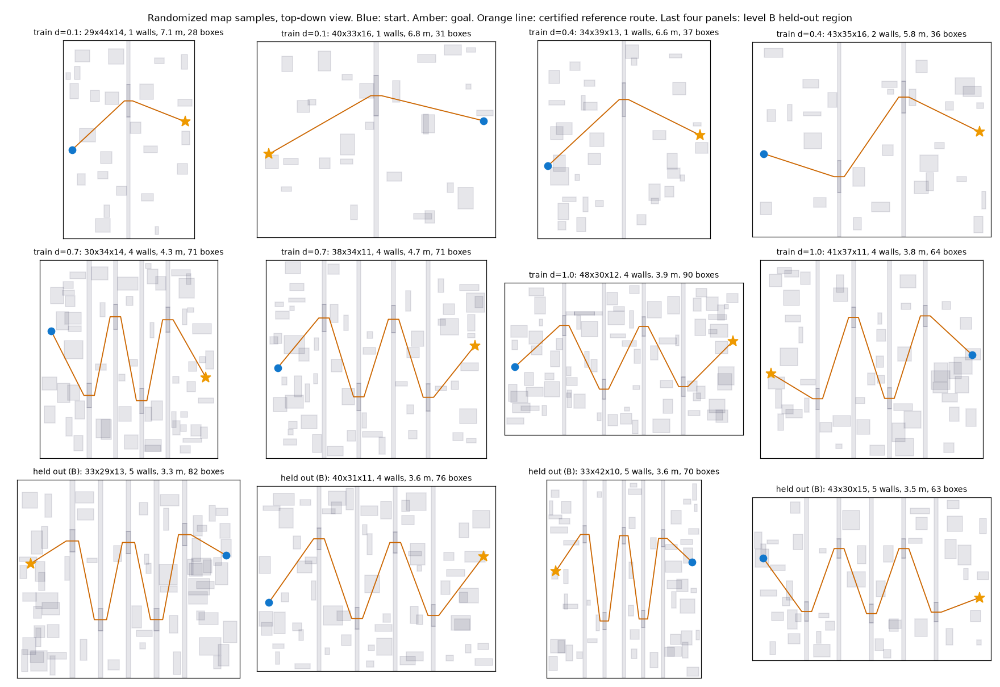

# Randomized map sampler (Phase 2, action R3)

Implemented October 10, 2026 in `fly_rl/simulation/random_profiles.py`. It chooses profile parameters. The geometry, the certified route and the validity checks come from the existing generator (`map_profiles.generate_layout`). Training with it has not started, and no policy was evaluated on it.

## What it draws

Every episode draws a new `MapProfile`. A scalar difficulty `d` in [0, 1] moves the parameters from easy to hard. Each draw adds a jitter of up to 0.15 to `d`, so neighboring difficulties overlap.

| Parameter | d = 0 | d = 1 |
| --- | --- | --- |
| Room length (x) | 28 to 48 m, uniform | same |
| Room width (y) | 28 to 44 m, uniform | same |
| Room height (z) | 10 to 16 m, uniform | same |
| Partitions | 0 | 5 |
| Opening width | 8.0 m | 3.2 m |
| Opening height | 5.5 m | 3.2 m |
| Extra obstacles beyond the partitions | 8 | 70 |
| Dead-end branches | none | chance 0.5, one or two branches when there are at least two partitions |

Room length grows when needed so that every partition gets at least 2.5 m of spacing. The route clearance is 0.22 m. Every draw must pass the `MapProfile` validity checks, or it is redrawn.

## Adaptive difficulty

`DifficultyController` keeps one difficulty value, shared by all simulators. Over each window of 64 finished episodes, the value rises by 0.05 if the success rate is at least 0.7 and falls by 0.05 if it is at most 0.3. It stays between 0 and 1. The planned initial value is 0.2. These settings are declared here before any training and may change only through a committed protocol.

## Level B held-out region

The level B region is defined as an opening width below 3.8 m together with at least four partitions. The training sampler never draws a profile inside it (it redraws). The held-out sampler draws only inside it. The existing `large` profile (3.2 m, five partitions) lies inside the region, so it becomes a level B test. The profiles `passages` (4.0 m, three partitions) and `passages-wide` lie outside it and stay training-eligible.

Consequence: the hardest corner of the training distribution is the edge of the region, at four partitions with openings of 3.8 m or more. The held-out region asks the policy to handle narrower openings than any it trained on, and one more partition at most.

## Level C

The level C family is not chosen yet. The suggestion in the roadmap is the synthetic architectural scenes, which come from a different generator. The decision belongs to the user (action R4).

## What was measured

- 14 unit tests pass (`tests/simulation/test_random_profiles.py`): valid profiles at every difficulty, the training sampler never enters the level B region, the held-out sampler always does, repeatability from a seed, harder maps at higher difficulty, controller behavior and clamping, and a world that draws a new valid layout every episode and reports outcomes to the controller.
- 150 resets at each of four difficulties produced no generation failure. A reset takes 0.003 s at difficulty 0.1 and 0.05 s at difficulty 1.0, so layout generation does not slow training.
- The mean episode limit grows with difficulty: about 1,400 ticks at d = 0.1 and 2,400 ticks at d = 1.0.
- A gallery of samples is in [random-profile-gallery.png](images/random-profile-gallery.png). The last four panels are held-out draws.

## Limits

- All sampled maps share the structure of the existing generator: partitions across the room length with alternating openings, and an obstacle field. The sampler varies the parameters of that structure. It does not create a new kind of map, so level A and level B tests stay within this structure. Level C needs a different generator.
- The held-out region removes only the narrow, many-partition corner. A policy that fails there may also fail at the edge of the training range.
- The v2 sensor scales distance by a fixed constant and altitude by the original room height, so rooms taller or longer than the training rooms change the input scale. The earlier transfer work used rooms up to 32 by 32 by 12 m for training, and the policy has been evaluated, not trained, on 48 by 48 by 16 m rooms. Training on the sampler will be the first training in those sizes.
