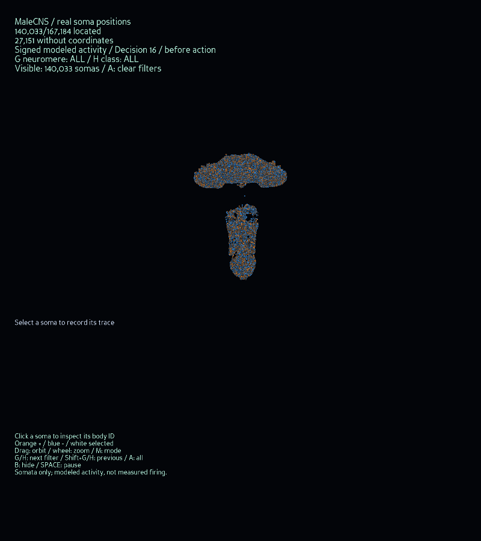
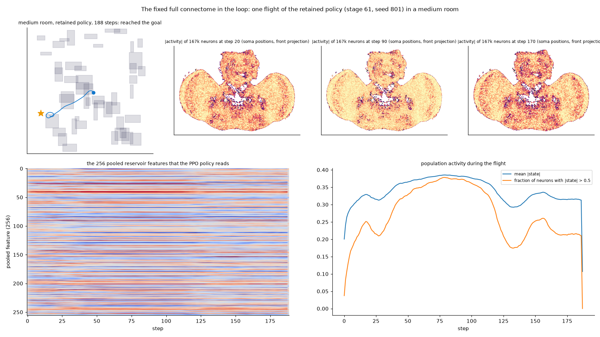
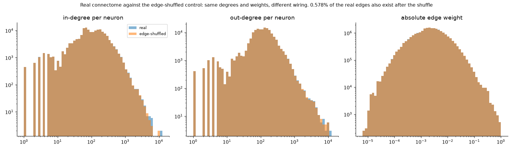

# The connectome reservoir, sensors, readouts and policy

This page covers the biological part of the controller: where the wiring comes from, how it is turned into a fixed recurrent network, what the flight sensors feed into it, how its activity becomes the policy's input, what the PPO policy learns, how the viewer shows the brain, and the edge-shuffled control. The full equations, with their citations, are in [MATHEMATICS.md](MATHEMATICS.md). The map families are in [MAPS.md](MAPS.md); terms are in [GLOSSARY.md](../overview/GLOSSARY.md).

Code checked for this page: `fly_rl/connectome/data.py`, `brain.py`, `anatomy.py`, `shuffled.py`, `readout.py`, `innovation.py`, `dual_readout.py`, `repeatable_readout.py`, `segmented_readout.py`, `distance_readout.py`, `fly_rl/simulation/sensors.py`, `world.py`, `fly_rl/training/learning.py`.

## Data source

The wiring is **MaleCNS v1.0**, the male central nervous system connectome released by the Janelia FlyEM project and its collaborators. The project pins this release for reproducibility. Credit, license (CC BY 4.0) and the primary citation are in [DATA_AND_MODEL.md](../overview/DATA_AND_MODEL.md) and [REFERENCES.md](../reference/REFERENCES.md).

The downloader (`data.py`, function `download`) reads three official tables from the release directory:

- `body-annotations-male-cns-v1.0-minconf-0.5.feather` (annotations, soma positions, neuromeres, superclass)
- `body-neurotransmitters-male-cns-v1.0.feather` (predicted neurotransmitter per body)
- `connectome-weights-male-cns-v1.0-minconf-0.5.feather` (synapse counts per directed body pair)

Each download is written to a partial file and then renamed. Each raw file's SHA-256 is recorded in `raw/manifest.json`, and a cached file whose hash differs from a previous manifest is refused.

### Neuron selection and the graph

A body is retained when its status is `Traced` or it has a superclass, excluding statuses `Glia`, `Orphan` and `Unimportant`. Every connection whose two endpoints are both retained is kept. The project applies no further synapse-count threshold; the `minconf-0.5` table is the input boundary.

| Audit quantity (`audit.json`) | Value |
| --- | ---: |
| Annotation rows | 211,577 |
| Retained neurons (graph size) | 167,184 |
| Excluded annotation rows | 44,393 |
| Source connection rows | 151,856,684 |
| Retained directed edges (nonzero matrix entries) | 25,583,622 |
| Connections excluded because an endpoint was not retained | 126,273,062 |
| Represented synapses | 124,176,995 |
| Isolated retained neurons | 548 |
| Neurons with a GABA sign | 20,228 |
| Retained neurons with usable soma coordinates | 140,033 |
| Retained neurons without usable soma coordinates | 27,151 |

These counts are the recorded values from the audit, as stated in [DATA_AND_MODEL.md](../overview/DATA_AND_MODEL.md). The processed dataset fingerprint is `aff3a08b4b506711ea87109a21d5a3face06599183046ec9d9eba560d9d39d85`. Isolated neurons are kept in the graph so that the neuron count is the full annotated set.

### How the matrix is built

`prepare()` in `data.py` builds the matrix as follows:

1. Neuron IDs are the sorted unique retained body IDs. A sign vector starts at +1, and each body with neurotransmitter `gaba` (case-insensitive) becomes -1. Every other neurotransmitter, including unknown, is +1.
2. Each batch of connections is joined to the neuron index. Rows whose endpoints are not both retained are dropped and counted as excluded fragment edges.
3. The synapse counts `C` form a CSR matrix in the orientation **matrix[postsynaptic, presynaptic]**. Duplicate pairs are summed.
4. The stored graph multiplies each column (presynaptic source) by its sign and each row by `0.9 / max(1, incoming)`, where `incoming` is the row sum of `C`.

So the stored matrix is `W_ij = 0.9 * sigma_j * C_ij / max(1, sum_k C_ik)`. Every row's absolute sum is at most 0.9. The sign rule is an approximation; GABA marks a neurotransmitter prediction, not a measured synaptic sign.

### Checks before use

`prepare()` writes `synapse_counts.npz`, `brain.npz`, `neuron_ids.npy`, `neuron_signs.npy` and `audit.json` (with the SHA-256 of each processed file and of the raw files). `Brain.__init__` in `brain.py` then:

- reads `audit.json`, recomputes the SHA-256 of each processed file, and refuses a mismatch;
- requires the matrix to be square and to have as many rows as `annotated_neurons`.

A checkpoint records the reservoir fingerprint (see [Policy](#ppo-policy-and-what-is-learned)), so a checkpoint is not loaded onto a changed graph. The prepared data live under `data/`, which is local and not shipped.

## The reservoir update

The reservoir is a fixed random-sensor-driven recurrent network with no gradients. The constants below are the code's values (`brain.py`, `MODEL_SPEC = reservoir-v2-<sensor>-256-seed42-leak0.5-scale0.9`).

| Item | Implementation | Value |
| --- | --- | --- |
| Recurrent matrix | `W` above, sparse CSR on the chosen device | 167,184 x 167,184, 25,583,622 entries |
| Leak | new state = 0.5 * old state + 0.5 * tanh(...) | 0.5 |
| Scale | row absolute sums | 0.9 |
| Nonlinearity | elementwise `tanh` | — |
| Input mapping | each neuron reads two sensor values | seed 42 |
| Pooling | 256 buckets, seeded signs, normalized by `sqrt(bucket size)` | seed 42 |

One update is

```text
h(t+1) = 0.5 * h(t) + 0.5 * tanh( W h(t) + u(t) )
```

with the sensory input for neuron i

```text
u_i(t) = 0.5 * ( e_i1 * x_{q_i1}(t) + e_i2 * x_{q_i2}(t) )
```

where `q_i1`, `q_i2` are sensor indices and `e_i1`, `e_i2` are signs drawn from `default_rng(42)` (`input_index`, `input_sign`). Each neuron is assigned to one of 256 pooled features (`bucket`) with a seeded sign. The feature vector is

```text
z_k(t) = sum over {i : bucket_i = k} of ( eta_i * h_i(t) ) / sqrt( max(n_k, 1) )
```

An empty bucket is zero. Features are not clipped and do not have unit variance. Each episode resets its activity to zero (`reset`).

Extra terms appear only for later sensor versions:

- **v4 (deadline):** a fixed clock weight per neuron (`default_rng(104729)`, values in {-0.25, 0, +0.25} with probabilities 0.125, 0.75, 0.125) multiplies the remaining-time value.
- **v5 and v6 (visual):** each neuron reads two more sensor values from the visual block (`default_rng(123457)`), scaled by 0.25 and centered at 0.5 for the distance channels and at 0 for the approach channels.

The seeds fix the sensory projection and the pooling. The documents describe these as seeded engineering choices, not anatomically validated mappings of rays to cells ([DATA_AND_MODEL.md](../overview/DATA_AND_MODEL.md)).

`Brain.step` runs on the device given (CUDA by default; CPU only when requested explicitly, and never reduced automatically). Actor and critic run on CPU. The fixed step takes the sensor batch and returns the 256 pooled features per batch element.

The same update can be sanity checked: the infinity-norm Lipschitz bound of the recurrent map for identical inputs is 0.5 + 0.5 * 0.9 = 0.95 ([MATHEMATICS.md](MATHEMATICS.md)). This bounds the update; it does not establish closed-loop stability.

## Sensor versions

Sensor versions are declared in `fly_rl/simulation/sensors.py`. Each world and each brain declares one; a mismatch is rejected (`BrainEnv` checks it). The sensor count is computed from the declared version.

| Version | Count | What it adds |
| --- | ---: | --- |
| `sensors-v2-128-distance-128-approach-13-state` (default) | 269 | 128 distance rays, 128 approach readings, 13 state values |
| `sensors-v3-...-room-scales-yaw-rate` | 269 | Same order; distance and altitude scaled by the room; state yaw rate |
| `sensors-v4-...-deadline` | 270 | v3 plus remaining-time fraction |
| `sensors-v5-v3-plus-589-goal-fan-rays-range24` | 1,447 | v3 plus 589 goal-centered fan rays |
| `sensors-v6-v3-plus-1800-body-panorama-rays-range24` | 3,869 | v3 plus 1,800 body-frame panorama rays |

Details, all verified in `sensors.py` and `world.py`:

- **Distance rays (128).** 26 box directions (the 3 x 3 x 3 grid minus the origin, normalized) plus 102 quasi-uniform sphere points. Range 8. The distance is the first hit on a room wall or obstacle, capped at 8 and divided by 8 for the input. Rays are cast from the fly center against the raw boxes; they do not inflate obstacles by body radius.
- **Approach readings (128).** Each ray direction dotted with the world velocity, divided by 3.
- **State (13).** Target direction in body coordinates (3), target distance (1), local velocity divided by 3 (3), the four previous commands (4), altitude (1) and yaw rate (1). The target distance is divided by 18 in v2 and by the interior room diagonal in v3. Altitude is divided by 6 in v2 and by the room height in v3. In v2 the last value is the previous yaw command; in v3 it is the measured yaw rate divided by 2.6 rad/s. All values are clipped to [-1, 1].
- **Fan (v5).** 31 azimuths from -75 to +75 degrees and 19 elevations from -45 to +45 degrees, centered on the observed target bearing. Distances are divided by 24. Speed readings are divided by 3.
- **Panorama (v6).** 72 azimuths (step 5, from -180 to 175 degrees) and 25 elevations (-84 to +84 degrees), in body coordinates, 1,800 rays of range 24. The layout is elevation rows and azimuth columns.

The state and the target bearing are the engineered interface that the project uses. The policy receives target direction directly through these values. There is no camera encoder or learned target detector. See [SENSORS_V3.md](../methods/SENSORS_V3.md) for the v2-to-v3 change and its protocol.

Visual rays do not reveal the certified route or aperture. The v6 panorama uses body heading only ([MAPS.md](MAPS.md#geometry-rules)).

## What the policy sees

The policy's input is the pooled feature vector, not the sensor vector. `BrainEnv.step_wait` (`learning.py`) returns `brain.step(...)` output; the raw sensors are stored only in `info['next_sensors']` for analysis and logging.

- **Default readout** (`random-pool-256-v1`): 256 features.
- **Planner readouts** (see below): their own widths, for example 5,669 for the dual readout (3,869 contextual coordinates plus 1,800 clean ranges, `dual_readout.py`).
- **History option:** `--history-frames 32 --history-stride 8` stacks past feature vectors (up to 128 frames, stride up to 64). The temporal extractors in `learning.py` (`ResidualBrainHistory` and the panoramic/spatial extractors) read those frames.

Terminal and reset observations are handled inside `BrainEnv.step_wait` so that the recurrent state of continuing environments is preserved.

## Readout variants

The readout decides how neural activity becomes the policy input. The versions are declared as module-level strings and checked in `BrainEnv.__init__`. Each has its own model fingerprint so that checkpoints cannot silently load on another readout.

| Readout string | Class | Use |
| --- | --- | --- |
| `random-pool-256-v1` | `Brain` | Default; the 256 pooled features above. |
| `input-associated-neural-mean-v1` | `InputGroupedBrain` | Mean activity of neurons grouped by their sensor assignments (v5/v6 only). |
| `neural-innovation-least-squares-v1` and whitened, contrast, motion-stable and distance-stable variants | `innovation.py`, `distance_readout.py` | Diagnostic and engineered reconstructions of sensory coordinates from full neural activity; not biological evidence. |
| `neural-projection-dual-map005-distance-clean-v1` | `DualActivityBrain` | Planner-1.2 dual feature set: contextual map coordinates plus clean distance ranges. |
| `neural-projection-dual-repeatable-index-add-v1` | `RepeatableDualActivityBrain` | Same formulas with deterministic `index_add` accumulation (planner-1.3-exp.22). |
| `neural-projection-dual-repeatable-segmented-v1` | `SegmentedDualActivityBrain` | Same formulas with segmented CSR sums (planner-1.3-exp.23 and the planner-1.4 adapter). |

The dual and repeatable/segmented readouts reconstruct the previous and current neuron states through the known sensory projection and recurrent subtraction, then solve a least-squares problem with a Cholesky factor. This is an engineered information construction, not a claim of biological vision ([MATHEMATICS.md](MATHEMATICS.md), [MAZE_NAVIGATION.md](../planner/MAZE_NAVIGATION.md), [CONTROLLER_VERSIONS.md](../planner/CONTROLLER_VERSIONS.md)).

The planner controllers are hand-written observed-map controllers that read these features. They are not PPO policies. The architectural planner (planner-1.4) receives the v6 panorama and segmented dual features and the scene dimensions ([ARCHITECTURAL_NAVIGATION.md](../planner/ARCHITECTURAL_NAVIGATION.md)).

## PPO policy and what is learned

The learned part is a Stable-Baselines3 PPO with an MLP policy (`make_policy` in `learning.py`):

- actor and critic each: two hidden layers of 128 units (`net_arch` pi and vf); the code does not set an activation, so SB3's `MlpPolicy` default (tanh) applies;
- learning rate 3e-4; batch 128; 512 steps per rollout (128 in smoke runs); 5 epochs per update; discount 0.995; GAE lambda 0.95; clip range 0.2;
- the actor is a diagonal Gaussian over the four raw command components, with learned means and log standard deviations; commands are clipped to [-1, 1] before they reach the simulator ([MATHEMATICS.md](MATHEMATICS.md#ppo-what-is-optimized)).

What is fixed and what is learned:

| Component | Status |
| --- | --- |
| Connectome matrix, signs, edges | Fixed, from MaleCNS; never updated |
| Sensor-to-neuron mapping, signs, pooling (seed 42) | Fixed |
| Recurrent update, leak 0.5, scale 0.9, tanh | Fixed |
| Actor and critic MLPs | Learned by PPO |
| Optional temporal extractor (history option) | Learned, initialized to zero residual when transferred |
| Planner logic and its thresholds | Hand-written; versioned, not learned |

The reservoir has no gradients and no synaptic learning. Checkpoint metadata stores the reservoir fingerprint (the graph audit fingerprint joined to the model specification), the readout version, the sensor version and the environment. Loading a checkpoint on a different fingerprint, readout or sensor contract raises an error ([learning.py](../../fly_rl/training/learning.py)).

Whether a given checkpoint learned navigation is a result, not a property of the architecture. Results are in [RESULTS.md](../results/RESULTS.md) and [EXPERIMENT_LOG.md](../EXPERIMENT_LOG.md).

## Viewing the brain

The brain view is a separate window that shares the simulation and the graph. It starts no training and adds no recurrent model. It is opened by `--brain-view` on `demo` and by `B` in the fly window. The launchers are in [COMMANDS.md](../operations/COMMANDS.md):

```powershell
.\launch-dense.cmd --brain-region T1 --trace-neuron 10069
.\launch-dense.cmd --brain-region T1 --trace-neuron 10069 --record-brain
.\.conda\python.exe -s -m fly_rl demo --room-mode dense --dynamics coordinated --brain-view
```

- **Layout.** The view joins the retained body IDs to official `somaLocation` coordinates. 140,033 neurons are placed; 27,151 remain in the graph but have no soma position and are not placed. Coordinates are scaled uniformly to fit, with the vertical axis reflected. They are soma locations, not neurite morphology or synaptic paths.
- **Regions and classes.** G cycles the soma-neuromere filter, H cycles the superclass, and Shift reverses either sequence. A clears filters. Labels are the official annotations, including explicit "unassigned" values. Anatomical borders are not inferred.
- **Modes.** M cycles three colorings: **activity** (the signed current value of the state), **recent change** (difference from the previous sampled observation), and **local action sensitivity** (a local derivative of a selected policy action through the signed feature pooling). None of these is a firing rate, and the sign colors do not identify excitation or inhibition.
- **Selection.** Clicking a visible soma selects its real body ID. `--trace-neuron` opens a timeline for that body.
- **Timeline.** Observations are sampled every five decisions, before the action is applied, and held in memory for at most 240 samples (about 60 seconds of simulated time). The chart overlays the selected neuron's signed activity with the four commands. A reset or a sampling gap breaks the line.
- **Recording.** `--record-brain` also saves complete 167,184-value neuron snapshots every simulated second. Pooled features cannot recover these vectors.
- **Controls.** Drag rotates, the wheel zooms, Space pauses the shared simulation, Shift accelerates it, and Escape or B minimizes the view.

Figure of the separate activity window from the architectural demo:



A figure of a selected-neuron trace: 

Verified scope, as recorded in [FLIGHT_AND_NEURONS.md](FLIGHT_AND_NEURONS.md): a 40-decision archive held eight selected-neuron observations and two complete snapshots, and the observations matched the recorded actions. Physical keyboard focus, multi-monitor scaling and long interactive sessions were not fully tested. Requested speed can exceed real throughput.

## The edge-shuffled control

`fly_rl/connectome/shuffled.py` builds a control reservoir that keeps the neuron count, edge count, weight values, signs, input mapping, pooling, leak and scale, and changes only who connects to whom.

**How.** `shuffle_targets(matrix, seed)` takes the COO entries and applies one random permutation (`default_rng(seed).permutation(nnz)`) to the row (target) array. The column (source) array and the data array stay in place. The result is converted to CSR, which sums duplicate (target, source) pairs.

**Preserved:**

- each source neuron's out-degree (the column count), except where duplicates merge;
- each source's weights and signs (so the Dale-style sign of every edge is unchanged);
- each target's in-degree, because the multiset of row values is unchanged;
- the total number of edges before duplicate merging, the weight distribution, neuron count, input mapping, pooling, leak and scale.

**Changed:** which target each edge reaches. Duplicate (target, source) pairs created by the shuffle are summed. For the seed used in the control (seed 1) this merges about 0.34 percent of edges: 25,583,622 become 25,496,103 ([CONNECTOME_CONTROL_PROTOCOL.md](../experiments/connectome-control/CONNECTOME_CONTROL_PROTOCOL.md)).

**Identity.** `ShuffledBrain` records the fingerprint `shuffled-targets-seed<seed>-<16-hex digest of indices and indptr>-from-<first 12 characters of the real fingerprint>`. For seed 1 the recorded value is `shuffled-targets-seed1-ffe7773733e5096a-from-aff3a08b4b50`. The shuffled graph is rebuilt from the seed in a few seconds and is never stored.

Note: `ShuffledBrain` loads `brain.npz` directly and does not run the checksum loop that `Brain` runs. It reads the real fingerprint from `audit.json`. The processed-file checks are therefore not repeated for the shuffled graph.

**Why it is the control.** It is the reservoir that keeps everything except the biological wiring. A learned policy on the real graph that does no better than the same policy on this graph does not show a benefit from the connectome. The pre-training diagnostic (`scripts/check_shuffled_graph.py`) compared features from random sensor input: mean absolute feature 0.278 (real) and 0.280 (shuffled), standard deviation across features 0.348 and 0.344, and zero state saturation in both. The graphs are therefore not dead or saturated in different ways ([protocol](../experiments/connectome-control/CONNECTOME_CONTROL_PROTOCOL.md)).

**What the control has shown so far.** At the first stage (C1.0), a fresh real-connectome policy reached 61/64 deterministic successes on medium rooms at 884,736 transitions, and a fresh shuffled policy reached 54/64 at the same budget. That stage was a feasibility check; its chain gate required the real arm to reach at least 40/64 on medium rooms, and it did (61/64). ([C10 results](../experiments/connectome-control/CONNECTOME_CONTROL_RESULTS_C10.md)). The later stages (C1.1 and C1.2) were declared with a chain check: the fresh real arm must reach at least 28/64 on `passages`, and the retained lineage's `passages` results were 36 to 42. Both C1.1 and C1.2 failed that check, so their arm comparison cannot be used to make a claim about the retained lineage ([C11](../experiments/connectome-control/CONNECTOME_CONTROL_RESULTS_C11.md), [C12](../experiments/connectome-control/CONNECTOME_CONTROL_RESULTS_C12.md)). No conclusion about a biological benefit is drawn from this control.

A figure comparing real and shuffled reservoirs: 

## Related documents

- [MATHEMATICS.md](MATHEMATICS.md): the equations, reward, PPO and metric formulas, with citations.
- [DATA_AND_MODEL.md](../overview/DATA_AND_MODEL.md): the data pin, audit numbers and provenance of local policies.
- [SENSORS_V3.md](../methods/SENSORS_V3.md): the v3 sensor interface and migration.
- [FLIGHT_AND_NEURONS.md](FLIGHT_AND_NEURONS.md): flight dynamics and the anatomical viewer.
- [COMMANDS.md](../operations/COMMANDS.md): every command used here.
- [MAPS.md](MAPS.md): the maps the policy is evaluated on.
- [GLOSSARY.md](../overview/GLOSSARY.md): definitions.
