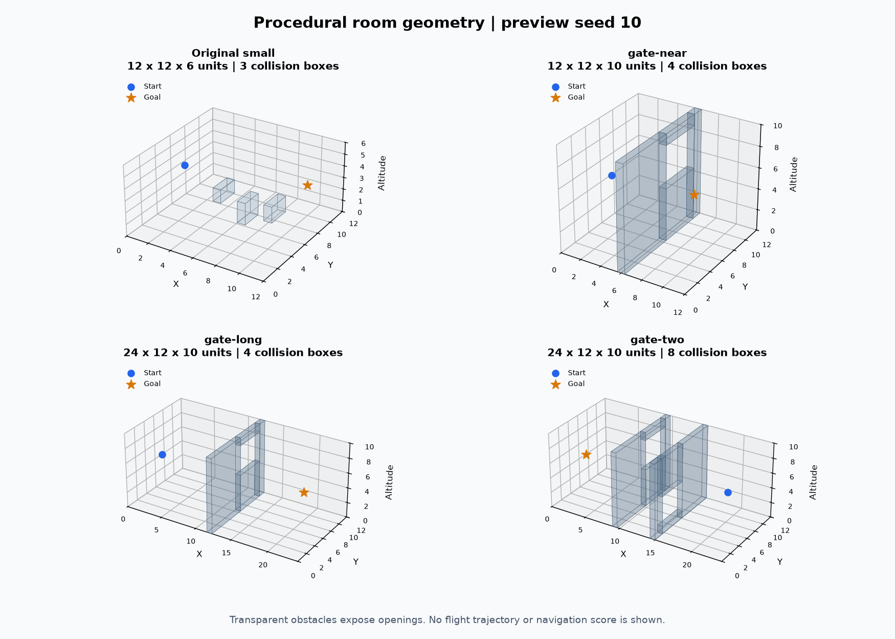
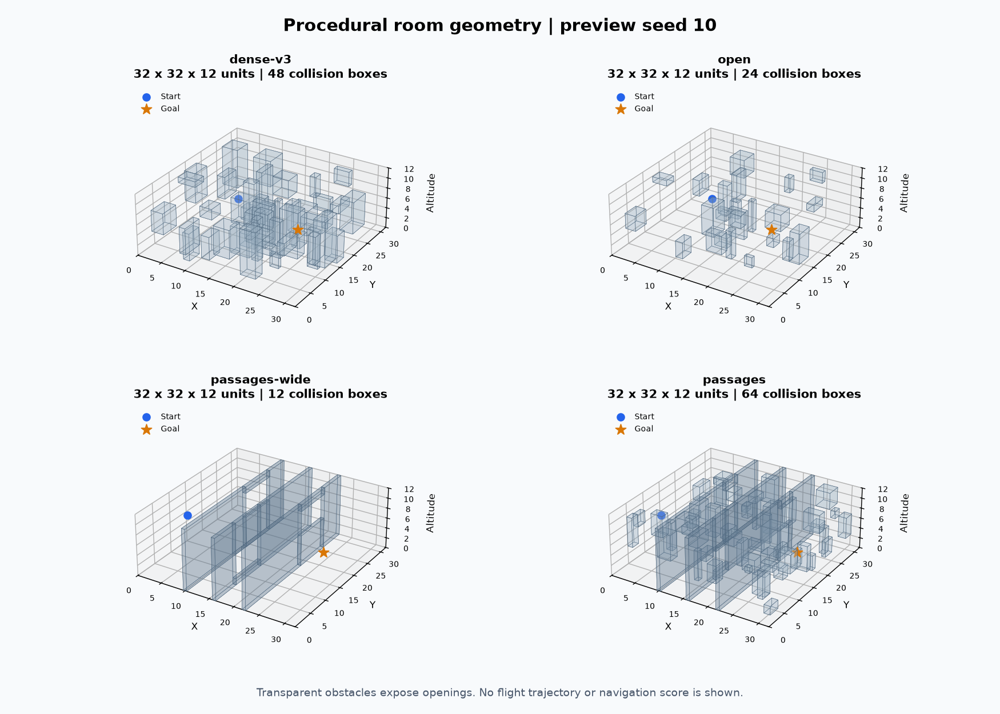
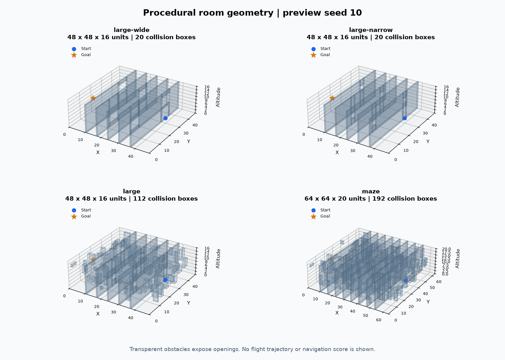
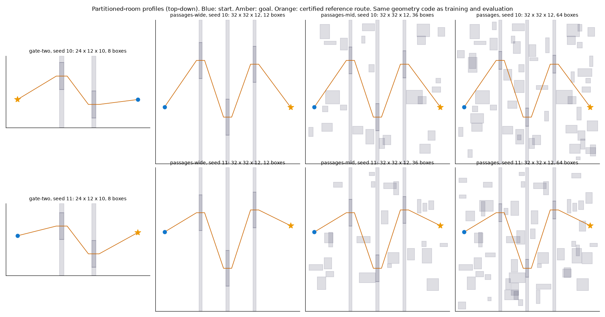
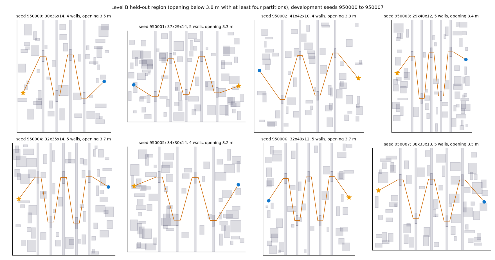
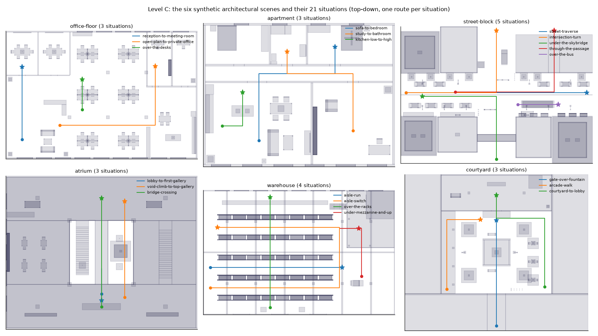

# Maps: profiles, families and geometry rules

This page describes every map family the project generates or renders: the parameters of each profile, how a profile is chosen for a run, the geometry rules that apply to all of them, how seeds become layouts, and what each family means for the release gate. It summarizes the code and links to the method documents for depth. The brain and sensors are described in [BRAIN.md](BRAIN.md); terms are defined in [GLOSSARY.md](../overview/GLOSSARY.md).

Sources checked for this page: `fly_rl/simulation/map_profiles.py`, `random_profiles.py`, `world.py`, `architectural_scenes.py`, `architectural_transfer.py`, `architectural_layouts.py`, `scripts/profiles/passages-mid.json`, and the method documents listed in the sections below.

## How a profile is chosen

A run names its map with one of these forms (see [COMMANDS.md](../operations/COMMANDS.md) for the exact flags):

- **None or `dense-v3`**: the original generator, 32 x 32 x 12 m, 48 boxes, 1,200-decision limit. It keeps its original random stream, so existing suite fingerprints are preserved.
- **A named profile** from `PROFILES` in `map_profiles.py`: `gate-near`, `gate-long`, `gate-two`, `passages-wide`, `large-wide`, `large-narrow`, `open`, `passages`, `large`, `maze`.
- **A JSON file** with the complete profile (`name`, `room_size`, `obstacle_count`, `wall_count`, `aperture_width`, `aperture_height`, `route_clearance`, `minimum_separation`, optional `branch_count`, `version`). The shipped example is `scripts/profiles/passages-mid.json`. The version must be `rooms-v4-profiled-passages`.
- **The randomized sampler** (`ProfileSampler` in `random_profiles.py`): a new profile for every episode, drawn from declared ranges.
- **The six architectural scenes** (`architectural_scenes.py`, `architectural_transfer.py`): a different generator with fixed geometry, selected by scene and situation index.

Profile-based runs are dense-room runs (`--map-profile` implies dense mode). A profile is a complete value: a frozen suite serializes the actual numbers, so editing a named preset or a JSON file cannot change an existing experiment. A checkpoint trained on one profile is rejected on another unless transfer is requested explicitly; transfer is not evidence of trained performance on the new map.

## Profile table

Dimensions are in meters (the room is x by y by z, with z up). "Boxes" is the total number of axis-aligned collision boxes, including the four boxes that make up each partition. Openings are the aperture width by height. "Clearance" is the extra margin the certified route keeps beyond the body radius of 0.16. "Limit" is the episode limit from the generator, in decisions (one decision is 0.05 s). The values below are read from `PROFILES` and the JSON file.

| Profile | Room | Boxes | Partitions | Opening (w x h) | Clearance | Min. endpoint separation | Branches | Limit | Where it is used |
| --- | --- | ---: | ---: | --- | ---: | ---: | ---: | --- | --- |
| Original small room (`obstacles`, legacy) | 12 x 12 x 6 | 3 | none | none | none | none | none | 600 (mode `obstacles`) | Introductory demo and legacy policies, not a profile. Code in `world.py`. |
| `gate-near` | 12 x 12 x 10 | 4 | 1 | 4.5 x 4.0 | 0.25 | 5 | 0 | generator | Passage-mastery practice stage zero, and a training profile. |
| `gate-long` | 24 x 12 x 10 | 4 | 1 | 4.5 x 4.0 | 0.25 | 14 | 0 | generator | Passage-mastery v2 final pool (61/64, see below). |
| `gate-two` | 24 x 12 x 10 | 8 | 2 | 4.5 x 4.0 | 0.25 | 14 | 0 | generator | Training mix (4 of the 32 simulators in the Phase 1, large-budget and control recipes) and an evaluation cell; the retained 2M checkpoints score 63 to 64 of 64 on it. |
| `dense-v3` (medium) | 32 x 32 x 12 | 48 | none (random field) | none | 0.35 (check inflation, see notes) | 14 | none | 1,200 | Original medium dense task; medium regression suite; historical results. |
| `open` | 32 x 32 x 12 | 24 | 0 | none | 0.25 | 14 | 0 | generator | Training variant in geometry-v1; the profile with no partitions and the highest reset probability in the first third of that schedule. |
| `passages-wide` | 32 x 32 x 12 | 12 | 3 | 8.0 x 4.8 | 0.25 | 14 | 0 | generator | Training mix (4 of 32 simulators) and an evaluation cell in the transfer, Phase 1, diagnostic, large-budget and control experiments (see [COMMITTEE_EVAL_RESULTS.md](../experiments/diagnostics/COMMITTEE_EVAL_RESULTS.md) for the sampled-mode finding). |
| `passages-mid` | 32 x 32 x 12 | 36 | 3 | 6.0 x 4.4 | 0.25 | 14 | 0 | generator | Training mix (12 of 32 simulators) and an evaluation cell from the Phase 1 and transfer experiments onward, including the connectome control. Defined in `scripts/profiles/passages-mid.json`. |
| `passages` | 32 x 32 x 12 | 64 | 3 | 4.0 x 4.0 | 0.25 | 14 | 0 | generator | The primary hard cell of the project (4 of 32 simulators in the training mix; the cell reported in the budget, replication and control experiments). |
| `large-wide` | 48 x 48 x 16 | 20 | 5 | 8.0 x 6.0 | 0.22 | 24 | 0 | generator | Defined; no experiment recorded in the documents read. |
| `large-narrow` | 48 x 48 x 16 | 20 | 5 | 3.2 x 3.2 | 0.22 | 24 | 0 | generator | Defined; no experiment recorded in the documents read. |
| `large` | 48 x 48 x 16 | 112 | 5 | 3.2 x 3.2 | 0.22 | 24 | 0 | generator | Structured large rooms; geometry-v1 final pool (0/64); level B region. |
| `maze` | 64 x 64 x 20 | 192 | 8 plus 4 dead-end wings | 2.4 x 2.8 | 0.18 | 36 | 4 | generator | Maze family; planner-1.3 maze development. |
| `passages-mid` (JSON) | 32 x 32 x 12 | 36 | 3 | 6.0 x 4.4 | 0.25 | 14 | 0 | generator | Same as the row above; the JSON file is the frozen definition. |

Notes that follow from the code:

- `open` has no partitions. Its 24 boxes are obstacles only.
- The `dense-v3` row is generated by a separate function (`_dense_layout` in `world.py`): a random three-segment lane route and up to 5,000 attempts to place 48 boxes. Its route check inflates each box by the body radius plus 0.35 m, and it has no `MapProfile` object or partition structure.
- A "partition" is four boxes around one opening (`generate_layout`). Partition pieces count toward `obstacle_count`. The validator requires `obstacle_count >= 4 * (wall_count + branch_count)`.
- `maze` branches are side wings with one doorway each. Neighboring partitions and the room wall close their other sides. The certified route enters each wing through its doorway, and the random boxes are kept out of those entrances. This is a chamber-and-wing topology, not an arbitrary grid maze ([MAZE_NAVIGATION.md](../planner/MAZE_NAVIGATION.md)).
- `MapProfile` bounds: room sides 10 to 96; at most 256 boxes; at most ten partitions; clearance 0.05 to 0.35; openings at least 0.5 and at most 40% of the room's y or z side; an opening must exceed twice the body clearance (`2 * (0.16 + clearance)`).

Images of the presets are rendered from the code (see [How to render maps](#how-to-render-maps)):

- Compact rooms (original small room, `gate-near`, `gate-long`, `gate-two`): 
- Medium rooms (`dense-v3`, `open`, `passages-wide`, `passages`): 
- Large rooms (`large-wide`, `large-narrow`, `large`, `maze`): 

The per-profile positions and checksums are recorded in [maps-manifest.json](../images/maps-manifest.json), which lists profile names, dimensions, collision-box counts and geometry checksums. Preview seed 10 was used; that is a rendering seed, not a test seed.

The partitioned profiles (the passage-style presets, see the rule table below) are shown here: 

## The randomized sampler and the level B region

`random_profiles.py` draws a new `MapProfile` for each episode. A scalar difficulty `d` in [0, 1] moves the parameters from easy to hard, with a jitter of up to 0.15 on each draw.

| Parameter | d = 0 | d = 1 |
| --- | --- | --- |
| Room x | 28 to 48 m, uniform | same |
| Room y | 28 to 44 m, uniform | same |
| Room z | 10 to 16 m, uniform | same |
| Partitions | 0 | 5 (rounded linear interpolation) |
| Opening width | 8.0 m | 3.2 m, plus uniform noise of plus or minus 0.3 m, clipped to [3.2, 8.0] |
| Opening height | 5.5 m | 3.2 m, clipped to [3.2, 5.5] |
| Extra boxes beyond partitions | 8 | 70, scaled by a factor between 0.7 and 1.3 |
| Dead-end branch chance | 0 | 0.5 (one or two branches when there are at least two partitions) |

Room x is increased when needed so that every partition has at least 2.5 m of spacing plus room for the ends. The total box count is `min(256, 4 * (walls + branch) + extra)`. Candidates that fail `MapProfile` validation are redrawn (up to 200 tries). The route clearance is 0.22 m and the minimum endpoint separation is `min(14, room_x - 4)`.

The **difficulty controller** (`DifficultyController`) keeps one difficulty value, shared by all simulators. It is updated over each window of 64 finished episodes: it rises by 0.05 if the success rate is at least 0.7, falls by 0.05 if it is at most 0.3, and stays between 0 and 1. Its initial value is 0.2. The settings were declared before any training; the sampler's effect on training results is not recorded in the documents read (see [MAP_SAMPLER.md](MAP_SAMPLER.md), which states that training with it had not started at the time of writing).

### Level B held-out region

The region is defined by `in_heldout_b` in `random_profiles.py`:

- opening width **below 3.8 m**, and
- **at least four partitions**.

The **training sampler never draws a profile inside the region** (it redraws; a test checks this). The **held-out sampler draws only inside it**. Its draws are: 4 or 5 partitions, opening width uniform in [3.2, 3.75], difficulty forced to at least 0.6.

The existing `large` profile (3.2 m openings, five partitions) lies inside the region. The profiles `passages` (4.0 m, three partitions) and `passages-mid` (6.0 m, three partitions) lie outside it and stay training-eligible. The hardest training corner is therefore the edge of the region, at four partitions with openings of 3.8 m or more.

Seed ranges for level B are in the [held-out specification](HELD_OUT_SPEC.md#level-b-held-out-parameter-region): development draws 950000 to 959999 and final assessment 960000 to 969999. The final assessment pool is reserved and, per the spec, is not to be opened before Phase 5.

The sampler is a generator of parameters for the existing structure. Level A and level B tests therefore stay within the same kind of map. [MAP_SAMPLER.md](MAP_SAMPLER.md) records the limits.

Gallery of sampled draws (the last four panels are held-out draws):


The gallery is produced by `scripts/render_random_profile_gallery.py` (output path defaults to `docs/images/random-profile-gallery.png`).

Level B draws only: 

## Architectural scenes (level C)

Six original synthetic architectural scenes are defined in `architectural_layouts.py` and assembled from named boxes by `architectural_parts.py`. Their geometry is validated by `architectural_scenes.py` (`validate`, which checks bounds, duplicate names, materials and that each reference route clears every solid by the body radius plus 0.2 m).

| Scene | Kind | Size (m) | Collision boxes | Situations |
| --- | --- | --- | ---: | --- |
| `office-floor` | interior | 30 x 20 x 3.4 | 404 | `reception-to-meeting-room`, `open-plan-to-private-office`, `over-the-desks` |
| `apartment` | interior | 16 x 12 x 2.8 | 137 | `sofa-to-bedroom`, `study-to-bathroom`, `kitchen-low-to-high` |
| `street-block` | outdoor | 70 x 50 x 18 | 224 | `street-traverse`, `intersection-turn`, `under-the-skybridge`, `through-the-passage`, `over-the-bus` |
| `atrium` | interior | 30 x 24 x 14 | 188 | `lobby-to-first-gallery`, `void-climb-to-top-gallery`, `bridge-crossing` |
| `warehouse` | interior | 40 x 26 x 10 | 395 | `aisle-run`, `aisle-switch`, `over-the-racks`, `under-mezzanine-and-up` |
| `courtyard` | mixed | 40 x 34 x 12 | 101 | `gate-over-fountain`, `arcade-walk`, `courtyard-to-lobby` |

There are 21 situations in total (3, 3, 5, 3, 4, 3). Each situation has one start, one goal, tags, and a reference polyline. The polyline is privileged validation metadata and must not enter a controller's observations.

These scenes are inspected development assets, not a reserved test and not reconstructions of real places. The level C rule in [HELD_OUT_SPEC.md](HELD_OUT_SPEC.md#level-c-held-out-family) restricts their use before Phase 5. Design details, the scene fingerprints and the geometry-only checks are in [ARCHITECTURAL_SCENES.md](ARCHITECTURAL_SCENES.md).

For evaluation, `ArchitecturalSceneWorld` (`architectural_transfer.py`) reproduces the protected geometry and reset logic with a configurable sensor version. Its deadline is `max(60, 2 * L / 1.5 + 15)` seconds converted to decisions, the same formula as the profiles. The only randomness is the initial heading.

Gallery and plans (generated from the same geometry):



## Geometry rules

These rules apply to every generated profile.

- **Certified reference route.** `generate_layout` stores a polyline through every opening, from start to goal (`world.reference_route`). For the partition profiles it passes through the aperture centers, with lead-in and lead-out segments. For the random-field profiles (including `dense-v3`) it is a three-segment route: start, a lane point, then the goal. The route is used by the generator, by evaluation and by reward computation in training only. It is never part of the policy's observations (`observe` does not read it).
- **Certificate clearance.** Every route segment must avoid each box inflated by the body radius (0.16) plus `route_clearance`. The room boundaries must leave the same margin. The check is `segments_hit_boxes` (closed slab intersection). This proves a geometrically feasible center path; it does not prove that the flight dynamics execute the path at a given speed.
- **Goal placement.** For partition profiles the start is at x = 2 and the goal at x = room_x - 2, with y and z drawn in [0.35, 0.65] of the room. The endpoints are reversed with probability 0.5. For random-field profiles the endpoints are placed uniformly inside a margin, and the separation is at least `minimum_separation` (up to 1,000 tries).
- **Collision.** A move is a collision if its swept segment intersects a box inflated by the body radius (`segment_box` against `low - RADIUS` to `high + RADIUS`), or if the new position leaves the room bounds inflated by the radius. The position is then clipped to the room.
- **Success.** The distance to the goal is below 0.45 and there was no collision on that step (`FlightWorld.step`).
- **Collision termination.** A collision ends the episode with reward -5 (`terminated`, `success = False`).
- **Timeout.** When the decision count reaches the episode limit without termination, the episode is truncated. The reward is reduced by 5. A timeout counts as a failure in every reported success rate.
- **Episode limit.** For generated profiles, `max(60, 2 * L_cert / 1.5 + 15) / 0.05` decisions, rounded up, where `L_cert` is the certified route length. The 1.5 units per second and the factor two are engineering allowances, not measured speeds. The original `dense-v3` limit is 1,200 decisions; the legacy small room is 600.
- **Metrics.** `difficulty_metrics` reports `geometry-v1-grid32-linf` descriptors: occupancy on a 32 x 32 x 16 grid, box-volume fraction, endpoint distance, certified route length and its ratio to the direct distance, turns over 15 degrees, vertical travel, the L-infinity clearance lower bound and `direct_path_blocked`. It sets `route_is_optimal` and `dynamic_feasibility_proven` to false. These are descriptors, not a calibrated difficulty score.

Physical QA of the two newest passage profiles used an oracle that follows the hidden certificate. It reached the goal in all 16 preview layouts. This is physical feasibility evidence for those examples, not learned success or a reachability proof, and the oracle is not part of training ([GEOMETRY_CURRICULUM.md](GEOMETRY_CURRICULUM.md)).

## Seeds, layouts and evaluation pools

- A layout is a function of the seed and the profile. `FlightWorld.reset(seed)` creates `rng = default_rng(seed)` and draws the layout from it. For a suite with `layout_seeds`, the sampler picks one seed from the frozen list.
- A **pool** is a named, frozen list of seeds for one split (training, validation or test). Pools are recorded in suite files (`runs/suites/*.json`). Suite loading regenerates the geometry and checks fingerprints.
- The **development pools** used for progress checks are inspected. The **reserved pools** are not opened before their stated phase. The rules and seed ranges are in [HELD_OUT_SPEC.md](HELD_OUT_SPEC.md), and the ledger of consumed pools is in [GENERALIZATION_AND_ROUTES.md](GENERALIZATION_AND_ROUTES.md) and [EXPERIMENT_LOG.md](../EXPERIMENT_LOG.md).
- Concrete ranges that are documented: the medium regression pools A (100000 to 100031), B (840000 to 840031), C (860000 to 860031) and D (861000 to 861031) in [MEDIUM_REGRESSION_SUITE.md](MEDIUM_REGRESSION_SUITE.md); the level A reserved report seeds 940000 to 949999; level B 950000 to 959999 (development) and 960000 to 969999 (reserved); level C headings 900000 and above (development) and 970000 to 979999 (reserved).
- The default suite ranges in the command reference are 30000 to 30255 (training), 40000 to 40031 (validation) and 50000 to 50063 (test); the earlier geometry-v1 suite used 280000 to 280255, 290000 to 290031 and 300000 to 300063 ([GEOMETRY_CURRICULUM.md](GEOMETRY_CURRICULUM.md)).
- The final pool of the passage-mastery v2 run and the geometry-v1 run are consumed. Their seed lists are not repeated here.

Consumed pools are not independent evidence for later choices. A pool that has informed a design is a development pool even if its seeds were never reported.

## How to render maps

All commands run from the repository root with the project interpreter.

```powershell
.\.conda\python.exe -s scripts/render_map_gallery.py
.\.conda\python.exe -s scripts/render_random_profile_gallery.py
.\.conda\python.exe -s scripts/build_architectural_scenes.py
```

- `render_map_gallery.py` renders the twelve named presets (compact, medium and large galleries) with preview seed 10 (`--seed`), writes PNGs and `maps-manifest.json` to `docs/images` (`--output`), and runs no brain or policy.
- `render_random_profile_gallery.py` writes the randomized-sampler gallery to `docs/images/random-profile-gallery.png` (or a path given as the first argument).
- `build_architectural_scenes.py` regenerates the OBJ/MTL/JSON scene files, the interactive preview (`index.html`), `gallery.png`, `plans.png` and a manifest in `assets/architecture/draft-0.2` (`--output` for another folder). It does not need a GPU. The architectural scene viewer is started with `launchers/current/launch-architecture.cmd` (see [ARCHITECTURAL_SCENES.md](ARCHITECTURAL_SCENES.md)).
- A profile can be inspected without a brain: `python -s -m fly_rl map-report --output reports/geometry-preview.json --figure reports/geometry-preview.png --count 8`. The figure shows the hidden certificate, which the controller never sees.
- A profile can be opened in the viewer without training: `python -s -m fly_rl demo --map-profile large --dynamics coordinated --brain-view`. This uses an untrained controller.

## What each family means for the release gate

The proposed release gate in [PROJECT_COMPLETION.md](../overview/PROJECT_COMPLETION.md) and [ZERO_SHOT_PLAN.md](../overview/ZERO_SHOT_PLAN.md) names four families, each reported separately: the historical medium dense rooms (`dense-v3`), the structured large rooms (`large`), mazes (`maze`), and the six synthetic architectural scenes. The gate asks for at least 52 successes in 64 completed episodes per family (81.25 percent; the 80 percent point-estimate target), at most three collisions per family, Wilson 95 percent intervals, per-scene results for architecture, and timeouts counted as failures.

The documents read for this page do not assign the other profiles (`gate-*`, `open`, `passages*`, `large-wide`, `large-narrow`) or the randomized sampler to a release family. They are training structure, development rooms, or control cells. Results on them are reported as such in [RESULTS.md](../results/RESULTS.md) and must not be counted toward a family.

Results so far, with the caveats from their documents:

- **Passage-mastery v2 (`gate-long` final pool).** Baseline seed 42 reached 61/64 (95.3 percent, Wilson 87.1 to 98.4 percent) with zero collisions and three timeouts; the untrained control reached 0/64. The pool is consumed. This is single-opening performance, not the historical large rooms ([passage-mastery-v2-results.md](../evidence/passage-mastery-v2-results.md)).
- **Geometry-v1 (fixed `large` rooms).** The selected curriculum checkpoint reached 0/64 (Wilson 0.0 to 5.7 percent) with one collision. The pool is consumed. The 80 percent target is unmet ([GEOMETRY_CURRICULUM.md](GEOMETRY_CURRICULUM.md)).
- **Medium regression suite.** A candidate must reach at least 17 of 32 in each of four pools and 88 of 128 in total; the historical 50/64 reference scores 93 of 128 ([MEDIUM_REGRESSION_SUITE.md](MEDIUM_REGRESSION_SUITE.md)).
- **Architectural scenes.** The planner-1.4 development check completed 18/21 goals with zero collisions and three timeouts. Development use only ([architectural-initial-navigation-results.md](../evidence/architectural-initial-navigation-results.md)).
- **Maze.** Planner-1.3 exp.9 reached all six retained and all eight fresh development layouts; the sample is small and the maze work is still open ([MAZE_NAVIGATION.md](../planner/MAZE_NAVIGATION.md)).

No family has passed the final release gate in the documents read.

Maps are also used in the connectome control. Its evaluation cells include `passages`, `passages-mid`, medium rooms, level B development maps and level C development headings ([CONNECTOME_CONTROL_PROTOCOL.md](../experiments/connectome-control/CONNECTOME_CONTROL_PROTOCOL.md)).

## Related documents

- [MAP_SAMPLER.md](MAP_SAMPLER.md): the randomized sampler, its difficulty controller and limits.
- [HELD_OUT_SPEC.md](HELD_OUT_SPEC.md): level A, B and C definitions and reserved seeds.
- [GEOMETRY_CURRICULUM.md](GEOMETRY_CURRICULUM.md): profile formulas, the geometry metrics, the passage-mastery protocol.
- [ARCHITECTURAL_SCENES.md](ARCHITECTURAL_SCENES.md): scene design and checks.
- [DENSE_ROOMS.md](DENSE_ROOMS.md): the original dense task.
- [MATHEMATICS.md](MATHEMATICS.md): reward, flight and metric formulas.
- [BRAIN.md](BRAIN.md): the connectome reservoir and the sensor inputs.
